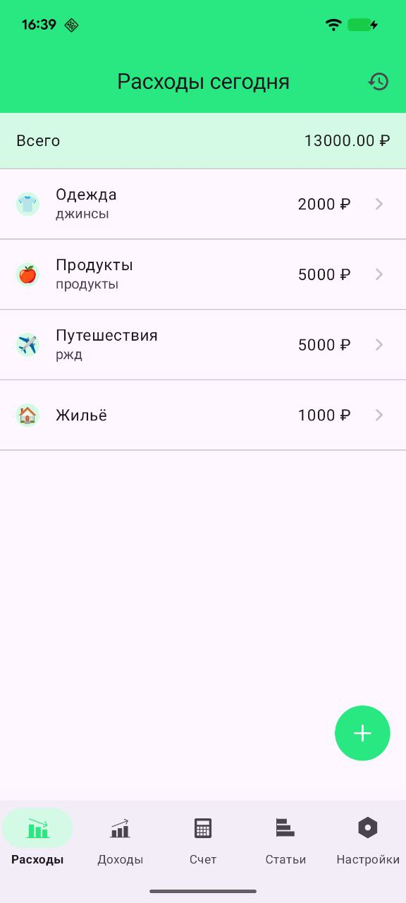
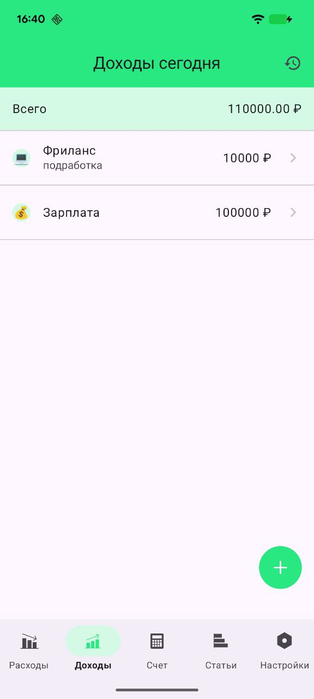
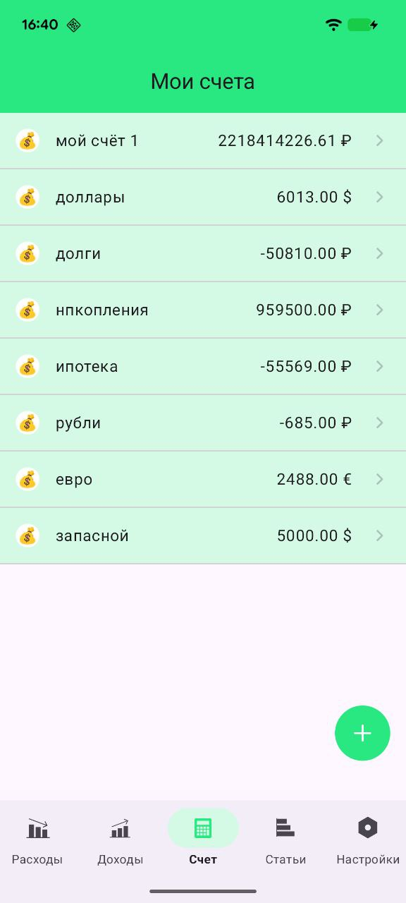
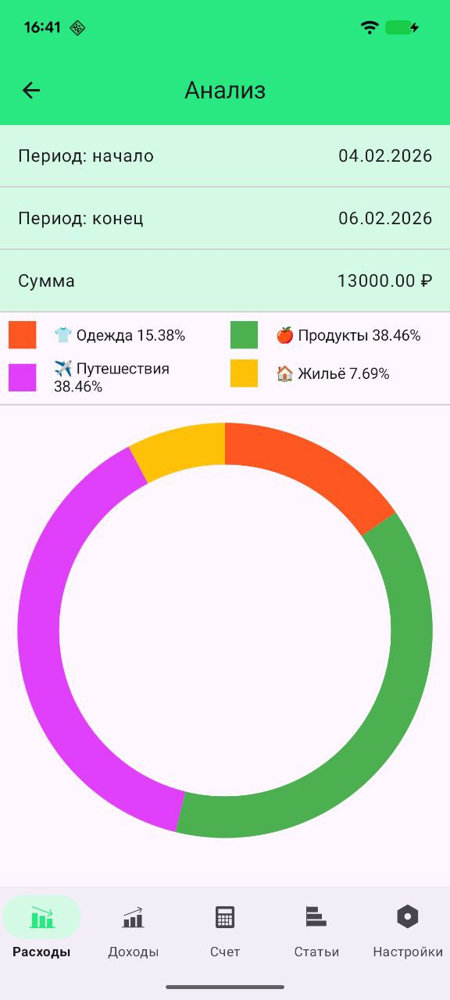
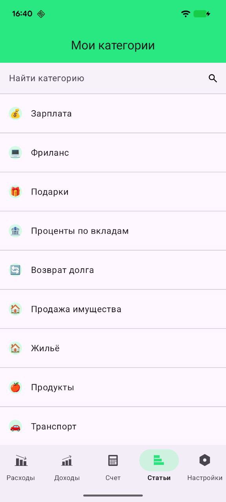
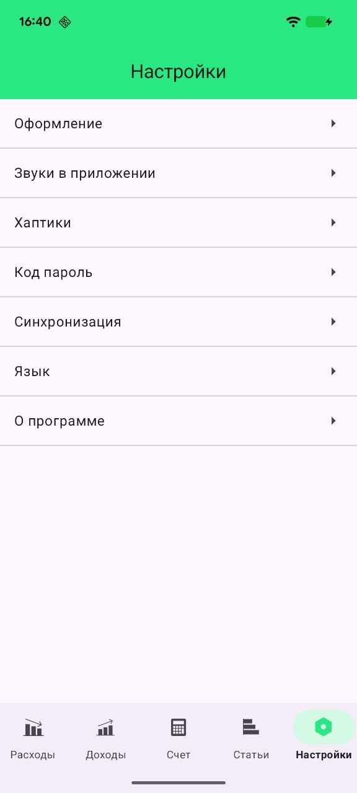
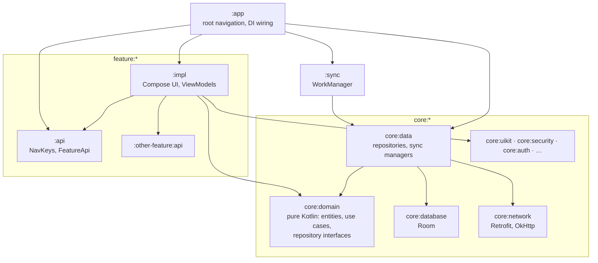

<p align="center">
  
</p>

<h1 align="center">Finance Manager</h1>

<p align="center">
  Offline-first Android personal finance app — a showcase of a multi-module Clean Architecture
  codebase where the architecture is enforced by CI, not by code review.
</p>

<p align="center">
  <a href="https://github.com/IliaVoskoboinikov/Finance-Manager/actions/workflows/ci.yml"></a>
  <a href="https://github.com/IliaVoskoboinikov/Finance-Manager/actions/workflows/security.yml"></a>
  <a href="LICENSE"></a>
  
  
  <a href="https://github.com/IliaVoskoboinikov/Finance-Manager/releases"></a>
  <a href="https://github.com/IliaVoskoboinikov/Finance-Manager/stargazers"></a>
</p>

<p align="center">
  <b>English</b> · <a href="README.ru.md">Русский</a>
</p>

> **Status: pre-release.** The app runs in guest mode without an account; the road to v1.0 on Google Play
> is tracked in the [milestone](https://github.com/IliaVoskoboinikov/Finance-Manager/milestone/1).

## Screenshots

<p align="center">
  
  
  
</p>
<p align="center">
  
  
  
</p>

Every screen and every `@Preview` of the app is also rendered by CI into a
[navigation map and preview gallery](https://iliavoskoboinikov.github.io/Finance-Manager/).

## Download

Pre-release APKs are attached to [GitHub Releases](https://github.com/IliaVoskoboinikov/Finance-Manager/releases).
Guest mode works without an account or network.

<!-- Google Play badge goes here once the app is published (FM-211). -->

## Features

- Income and expenses linked to accounts and categories, operation history.
- Accounts with balance and currency, predefined categories.
- Analytics by period, category and account.
- Background sync with a configurable interval; works fully offline.
- PIN and biometric lock, sign-in with a login or Yandex ID, or guest mode.
- Themes and design settings, in-app language switch, haptics and sounds.

## What's interesting here

A personal finance app is the domain; the point of the project is how it is built.

- **Offline-first sync.** Room is the single source of truth, the UI observes it via `Flow`, the
  network is only for background sync (WorkManager): split `localId` / `serverId`, soft deletes,
  category → account → transaction order, last-write-wins. → [docs/synchronization.md](docs/synchronization.md)
- **Navigation map generated from annotations.** Navigation 3 screens are spread across feature modules;
  `@NavDestination` / `@NavEdge` annotations are extracted at build time into a graph, and CI fails
  when the graph drifts from the committed baseline. → [docs/nav-graph.md](docs/nav-graph.md)
- **Architecture as a failing build.** [Aalekh](docs/aalekh.md) checks layers, feature isolation,
  reachability and cycles of the module graph; [Konsist](konsist/README.md) checks code placement
  (use cases, entities, DTOs, ViewModels); `assertModuleGraph` forbids `:impl → :impl` edges.
- **Own lint rules.** The [`:lint`](lint/README.md) module adds project-specific Android Lint checks,
  e.g. banning `java.util.Date` / `Calendar` in favour of `java.time`.
- **Convention plugins.** Every module is configured by a `soft.divan.*` plugin from
  [`build-logic`](build-logic/README.md); the plugins themselves are tested with Gradle TestKit.
- **95% coverage gate.** Kover fails CI when line coverage of testable (non-UI, non-generated) code
  drops below 95%. → [docs/testing.md](docs/testing.md)
- **Errors as values.** The domain layer never throws across boundaries: repositories and use cases
  return `DomainResult` with a sealed `DomainError`. → [docs/domain-result.md](docs/domain-result.md)
- **Own crypto layer.** [`CryptoManager`](core/security/README.md) (AES/GCM + Android KeyStore)
  encrypts the JWT; the PIN is hashed with PBKDF2 and salt before it is encrypted.

## Architecture

Clean Architecture + MVVM + unidirectional data flow, split into `app`, `core:*` and `feature:*`
modules; each feature has a public `:api` (navigation keys, `FeatureApi`) and a private `:impl`.



- [Architecture](docs/architecture.md) and [modularization](docs/modularization.md) — layers, data flow,
  module rules; [all modules](docs/modules.md) with their READMEs.
- [Full module graph](docs/graphs/modules_prodget/all_modules.png) (image) and the interactive
  [architecture report](https://iliavoskoboinikov.github.io/Finance-Manager/architecture/).
- [Navigation 3 setup](docs/navigation3.md) and the
  [navigation map](https://iliavoskoboinikov.github.io/Finance-Manager/nav-graph/nav-graph.html).

## Tech stack

| Area | Libraries and tools |
|------|---------------------|
| Language | Kotlin, Coroutines, Flow |
| UI | Jetpack Compose, Material 3, own components in `core:uikit` |
| Navigation | Navigation 3 (`NavKey` + `NavDisplay`), kotlinx.serialization |
| DI | Dagger Hilt |
| Storage | Room, DataStore |
| Network | Retrofit, OkHttp, Gson |
| Background work | WorkManager |
| Security | Android KeyStore, AES/GCM, PBKDF2 |
| Firebase | Crashlytics, Cloud Messaging (optional, see below) |
| Tests | JUnit 4, MockK, AssertJ, Robolectric, kotlinx-coroutines-test, Gradle TestKit |
| Quality | Detekt + compose-rules, ktlint, Android Lint + own rules, Konsist, Kover, Aalekh, dependency-guard |

Library versions live only in [`gradle/libs.versions.toml`](gradle/libs.versions.toml) and are kept up to
date by Renovate.

## Getting started

Requirements: **JDK 21** and a recent stable Android Studio (or the Android SDK with `ANDROID_HOME`).

```bash
git clone https://github.com/IliaVoskoboinikov/Finance-Manager.git
cd Finance-Manager
./gradlew :app:installDebug      # build and install the debug app
./gradlew testDebugUnitTest      # unit tests
```

No secrets are needed: a fresh clone builds and runs in guest mode. Optional configuration
(`local.properties` or environment variables, never committed):

| Key / file | What it enables |
|------------|-----------------|
| `app/google-services.json` | Crashlytics and push notifications; without it the build prints a warning |
| `YANDEX_CLIENT_ID` | sign-in with Yandex ID |

More commands — coverage, reports, graphs, ADB recipes: [docs/commands.md](docs/commands.md).

## Quality gates

Every pull request must pass, as separate CI jobs: build, unit tests, Kover coverage ≥ 95%,
Android Lint, Detekt, ktlint, Aalekh architecture check, module graph assertion, navigation graph
check, `dependency-guard` (release classpath baseline) and a secret scan. A change touching only
Markdown skips the code jobs. Details: [docs/ci-cd.md](docs/ci-cd.md).

## Documentation

Design docs live in [`docs/`](docs/README.md) and are written in **Russian**, the project's working
language. Start with [architecture](docs/architecture.md), [synchronization](docs/synchronization.md)
and [CI/CD](docs/ci-cd.md).

## Roadmap

Tasks, bugs and ideas are on the [task board](https://github.com/users/IliaVoskoboinikov/projects/5);
the path to the first release is the [v1.0 — Google Play](https://github.com/IliaVoskoboinikov/Finance-Manager/milestone/1)
milestone. After the release: data [export](https://github.com/IliaVoskoboinikov/Finance-Manager/issues/114)
and [import](https://github.com/IliaVoskoboinikov/Finance-Manager/issues/115),
[detailed analytics](https://github.com/IliaVoskoboinikov/Finance-Manager/issues/116),
[onboarding](https://github.com/IliaVoskoboinikov/Finance-Manager/issues/117),
[category budgets](https://github.com/IliaVoskoboinikov/Finance-Manager/issues/118),
[multi-currency](https://github.com/IliaVoskoboinikov/Finance-Manager/issues/62).

## Contributing

Questions and ideas — [Discussions](https://github.com/IliaVoskoboinikov/Finance-Manager/discussions);
bugs — [issues](https://github.com/IliaVoskoboinikov/Finance-Manager/issues/new/choose); security
problems — privately, see [SECURITY.md](SECURITY.md). How to build, check and submit a change:
[CONTRIBUTING.md](CONTRIBUTING.md).

## License

```
Copyright 2025 Ilia Voskoboinikov

Licensed under the Apache License, Version 2.0 (the "License");
you may not use this file except in compliance with the License.
You may obtain a copy of the License at

    http://www.apache.org/licenses/LICENSE-2.0

Unless required by applicable law or agreed to in writing, software
distributed under the License is distributed on an "AS IS" BASIS,
WITHOUT WARRANTIES OR CONDITIONS OF ANY KIND, either express or implied.
See the License for the specific language governing permissions and
limitations under the License.
```

---

<p align="center">Find this project useful? Give it a ⭐ — it helps others find it.</p>
