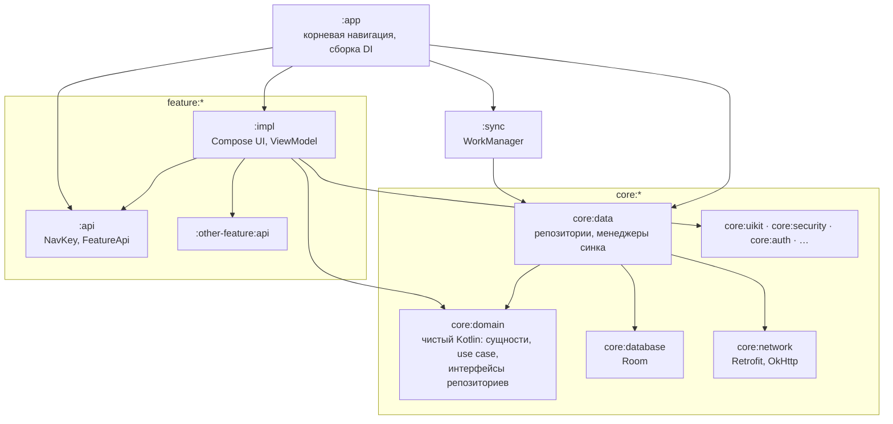

<p align="center">
  
</p>

<h1 align="center">Finance Manager</h1>

<p align="center">
  Offline-first Android-приложение для учёта личных финансов — витрина мультимодульной Clean
  Architecture, в которой архитектуру держит CI, а не код-ревью.
</p>

<p align="center">
  <a href="https://github.com/IliaVoskoboinikov/Finance-Manager/actions/workflows/ci.yml"></a>
  <a href="https://github.com/IliaVoskoboinikov/Finance-Manager/actions/workflows/security.yml"></a>
  <a href="LICENSE"></a>
  
  
  <a href="https://github.com/IliaVoskoboinikov/Finance-Manager/releases"></a>
  <a href="https://github.com/IliaVoskoboinikov/Finance-Manager/stargazers"></a>
</p>

<p align="center">
  <a href="README.md">English</a> · <b>Русский</b>
</p>

> **Статус: pre-release.** Приложение работает в гостевом режиме без аккаунта; путь к v1.0 в Google
> Play — в [milestone](https://github.com/IliaVoskoboinikov/Finance-Manager/milestone/1).

## Скриншоты

<p align="center">
  
  
  
</p>
<p align="center">
  
  
  
</p>

Все экраны и все `@Preview` приложения CI рендерит в
[карту навигации и галерею превью](https://iliavoskoboinikov.github.io/Finance-Manager/).

## Скачать

APK выкладываются pre-release-сборками в [GitHub Releases](https://github.com/IliaVoskoboinikov/Finance-Manager/releases) —
бери свежий `app-release.apk` там же, либо собирай из исходников (см. [Как запустить](#как-запустить)).
Гостевой режим работает без аккаунта и без сети.

<!-- Сюда — бейдж Google Play после публикации (FM-211). -->

## Возможности

- **Учёт операций:** доходы и расходы с привязкой к счетам и категориям, история операций.
- **Счета и категории:** счета с балансом и валютой, предопределённые категории.
- **Аналитика:** сводка по периодам, разбор по категориям и счетам.
- **Синхронизация:** фоновая через WorkManager (`:sync`) с настраиваемым интервалом; без сети
  приложение работает полностью.
- **Безопасность:** PIN-код и биометрия (`feature:security`); вход по логину, через Яндекс ID или
  гостевой режим.
- **Персонализация:** тема и дизайн-настройки (`feature:design-app`), язык приложения
  (`feature:languages`), вибрация и звуки (`feature:haptics`, `feature:sounds`).

## Чем интересен проект

Предметная область — личные финансы, но смысл проекта в том, как он построен.

- **Offline-first синхронизация.** Room — единственный источник правды, UI наблюдает его через
  `Flow`, сеть нужна только фоновому синку (WorkManager): раздельные `localId` / `serverId`, мягкое
  удаление, порядок категории → счета → операции, last-write-wins. → [docs/synchronization.md](docs/synchronization.md)
- **Карта навигации из аннотаций.** Экраны Navigation 3 разнесены по фича-модулям; аннотации
  `@NavDestination` / `@NavEdge` при сборке превращаются в граф, и CI падает, если граф разошёлся с
  закоммиченным бейзлайном. → [docs/nav-graph.md](docs/nav-graph.md)
- **Архитектура как падающая сборка.** [Aalekh](docs/aalekh.md) проверяет слои, изоляцию фич,
  reachability и циклы графа модулей; [Konsist](konsist/README.md) — где лежит код (use case,
  entity, DTO, ViewModel); `assertModuleGraph` запрещает рёбра `:impl → :impl`.
- **Свои lint-правила.** Модуль [`:lint`](lint/README.md) добавляет проектные проверки Android Lint,
  например запрет `java.util.Date` / `Calendar` в пользу `java.time`.
- **Convention plugins.** Каждый модуль настраивается плагином `soft.divan.*` из
  [`build-logic`](build-logic/README.md); сами плагины покрыты тестами на Gradle TestKit.
- **Гейт покрытия 95%.** Kover роняет CI, если покрытие строк тестируемого кода (без UI и
  сгенерированного) опускается ниже 95%. → [docs/testing.md](docs/testing.md)
- **Ошибки как значения.** Доменный слой не бросает исключений через границы: репозитории и use
  case возвращают `DomainResult` с sealed `DomainError`. → [docs/domain-result.md](docs/domain-result.md)
- **Своя криптография.** [`CryptoManager`](core/security/README.md) (AES/GCM + Android KeyStore)
  шифрует JWT; PIN перед шифрованием хешируется PBKDF2 с солью.

## Архитектура

Clean Architecture + MVVM + однонаправленный поток данных; модули `app`, `core:*` и `feature:*`,
у каждой фичи публичный `:api` (ключи навигации, `FeatureApi`) и закрытый `:impl`.



- [Архитектура](docs/architecture.md) и [модуляризация](docs/modularization.md) — слои, потоки
  данных, правила модулей; [все модули](docs/modules.md) со ссылками на их README.
- [Полный граф модулей](docs/graphs/modules_prodget/all_modules.png) (картинка) и интерактивный
  [отчёт архитектуры](https://iliavoskoboinikov.github.io/Finance-Manager/architecture/).
- [Устройство Navigation 3](docs/navigation3.md) и
  [карта навигации](https://iliavoskoboinikov.github.io/Finance-Manager/nav-graph/nav-graph.html).

## Технологии

| Область | Библиотеки и инструменты |
|---------|--------------------------|
| Язык | Kotlin, Coroutines, Flow |
| UI | Jetpack Compose, Material 3, свои компоненты в `core:uikit` |
| Навигация | Navigation 3 (`NavKey` + `NavDisplay`), kotlinx.serialization |
| DI | Dagger Hilt |
| Хранение | Room, DataStore |
| Сеть | Retrofit, OkHttp, Gson; свои interceptor'ы (Auth, Retry, NetworkConnection, Logging) |
| Фоновая работа | WorkManager |
| Безопасность | Android KeyStore, AES/GCM, PBKDF2 |
| Firebase | Crashlytics, Cloud Messaging (необязательно, см. ниже) |
| Тесты | JUnit 4, MockK, AssertJ, Robolectric, kotlinx-coroutines-test, Gradle TestKit |
| Качество | Detekt + compose-rules, ktlint, Android Lint + свои правила, Konsist, Kover, Aalekh, dependency-guard |

Версии библиотек — только в [`gradle/libs.versions.toml`](gradle/libs.versions.toml), обновляет их Renovate.

## Как запустить

Нужны **JDK 21** и свежая стабильная Android Studio (или Android SDK с `ANDROID_HOME`).

```bash
git clone https://github.com/IliaVoskoboinikov/Finance-Manager.git
cd Finance-Manager
./gradlew :app:installDebug      # собрать и поставить debug-сборку
./gradlew testDebugUnitTest      # юнит-тесты
```

Секреты не нужны: свежий клон собирается и запускается в гостевом режиме. Необязательная
настройка (`local.properties` или переменные окружения, в git не попадают):

| Ключ / файл | Что включает |
|-------------|--------------|
| `app/google-services.json` | Crashlytics и пуш-уведомления; без него сборка пишет предупреждение |
| `YANDEX_CLIENT_ID` | вход через Яндекс ID |

Остальные команды — покрытие, отчёты, графы, рецепты ADB: [docs/commands.md](docs/commands.md).

## Гейты качества

Каждый PR проходит отдельными джобами CI: сборку, юнит-тесты, покрытие Kover ≥ 95%, Android Lint,
Detekt, ktlint, проверку архитектуры Aalekh, проверку графа модулей, проверку графа навигации,
`dependency-guard` (бейзлайн релизного classpath) и поиск секретов. Правка только Markdown
пропускает джобы кода. Подробно — [docs/ci-cd.md](docs/ci-cd.md).

## Документация

Проектные документы — в [`docs/`](docs/README.md), на русском. Начать стоит с
[архитектуры](docs/architecture.md), [синхронизации](docs/synchronization.md) и [CI/CD](docs/ci-cd.md).

## Задачи и планы

Задачи, баги и идеи ведутся на [доске задач](https://github.com/users/IliaVoskoboinikov/projects/5).
Путь к первому релизу — [milestone «v1.0 — Google Play»](https://github.com/IliaVoskoboinikov/Finance-Manager/milestone/1),
порядок работ записан в его описании. Как устроен процесс — [docs/task-tracking.md](docs/task-tracking.md).

Продуктовые планы после релиза: [экспорт](https://github.com/IliaVoskoboinikov/Finance-Manager/issues/114)
и [импорт](https://github.com/IliaVoskoboinikov/Finance-Manager/issues/115) данных,
[подробная аналитика](https://github.com/IliaVoskoboinikov/Finance-Manager/issues/116),
[онбординг](https://github.com/IliaVoskoboinikov/Finance-Manager/issues/117),
[бюджеты по категориям](https://github.com/IliaVoskoboinikov/Finance-Manager/issues/118),
[мультивалютность](https://github.com/IliaVoskoboinikov/Finance-Manager/issues/62).

## Участие

Вопросы и идеи — в [Discussions](https://github.com/IliaVoskoboinikov/Finance-Manager/discussions);
баги — в [issues](https://github.com/IliaVoskoboinikov/Finance-Manager/issues/new/choose); уязвимости —
только приватно, см. [SECURITY.md](SECURITY.md). Как собрать, проверить и прислать изменение —
[CONTRIBUTING.md](CONTRIBUTING.md).

## Лицензия

Проект распространяется по лицензии [Apache License 2.0](LICENSE).
Copyright 2025 Ilia Voskoboinikov.

---

<p align="center">Проект оказался полезен? Поставьте ⭐ — так его проще найти другим.</p>
