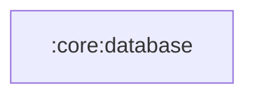

# `:core:database`

## Responsibility

Слой работы с базой данных приложения.

## Таблицы

| Таблица | Назначение |
|---|---|
| `transactions`, `account`, `category`, `currency` | доменные данные, Room — единственный источник истины |
| `outbox` | очередь исходящих операций: что нужно отправить на сервер, со статусом, счётчиком попыток и снимком запроса |

Очередь `outbox` наполняется **в той же Room-транзакции**, что и доменное изменение, поэтому
запись данных и намерение их отправить фиксируются атомарно. Дизайн и жизненный цикл записи —
[docs/outbox.md](../../docs/outbox.md), гарантии доставки — [docs/idempotency.md](../../docs/idempotency.md).

## Шифрование и доступ к базе

Файл базы всегда зашифрован SQLCipher (`SqlCipherDatabaseFactory`, готовый ключ `x'…'` —
`RawKey`). Базу можно закрыть (уровень PIN, автоблокировка, стирание), поэтому DAO не
инжектятся: доступ — через `DatabaseHolder` (`RoomDatabaseHolder`):

- `withDatabase { }` — разовая операция с арендой: база не закроется посреди неё;
- `observe { }` — поток, который молчит, пока база закрыта, и переподписывается после открытия;
- `bindToCurrentData { }` (`DataGenerationGuard`) — привязка работы к нынешним данным: после
  `wipe()` обращения к базе изнутри неё получают `StaleDataException`. Ей пользуется синк, который
  ходит в сеть без аренды и пишет ответ позже.

Модуль ключей не знает — холдер получает готовые байты; ключами управляет `:core:data`. Провайдер
холдера тоже в `:core:data` (ему нужен `@IoDispatcher`). Дизайн —
[docs/encryption.md](../../docs/encryption.md).

## Схема и засев

- Справочник категорий (`seed/DefaultCategories`, id — серверные GUID) засевается кодом:
  `SeedDatabaseCallback` кладёт его при создании базы и после деструктивной миграции, поэтому
  категории есть с первого запуска, в том числе у гостя без сети.
- Рабочий сборщик и тестовые базы, которые его имитируют (`TestDatabaseFactory`), используют
  `withAppDefaults()`: засев и деструктивный откат при смене версии (до релиза; настоящие
  миграции — FM-107). Чистые in-memory базы для тестов DAO собираются без засева.
- `DatabaseFiles` распознаёт незашифрованный файл от сборок до шифрования.

> Любое изменение схемы — включая новую таблицу — требует поднятия версии
> (`@Database(version = …)`).

Инструментальные тесты (`src/androidTest`) — на настоящем SQLCipher:
`./gradlew :core:database:connectedDebugAndroidTest`.

## Module dependency graph

<!--region graph-->

