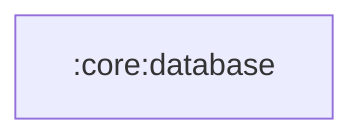

# `:core:database`

## Responsibility

Слой работы с базой данных приложения.

Справочник категорий (`seed/DefaultCategories`, id — серверные GUID) засевается кодом:
`SeedDatabaseCallback` кладёт его при создании базы и после деструктивной миграции, поэтому
категории есть с первого запуска, в том числе у гостя без сети.

## Module dependency graph

<!--region graph-->

