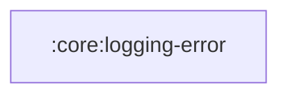

# `:core:logging-error`

## Responsibility

Логирование нефатальных ошибок: интерфейс `ErrorLogger` и его реализация
`CrashlyticsLogger` (Firebase Crashlytics, подключается через `CrashlyticsModule`).
Если `FirebaseApp` не поднят (сборка без `google-services.json`), ошибки пишутся только в logcat.

Исключение уходит в Crashlytics без текста: `redacted()` копирует цепочку `cause` в
`RedactedException` с типом и стеком каждого звена. Текст пишут библиотеки, и в него попадают
разбираемые значения (`DateTimeParseException: Text '…' could not be parsed`, Gson `JsonReader`:
`Expected a long but was …`). В logcat release-сборки — та же копия, полный текст — только в
debug (`BuildConfig.DEBUG`). Исходный тип — в тексте копии; чтобы R8 его не обфусцировал,
`consumer-rules.pro` сохраняет имена наследников `Throwable`.

Фатальные краши идут мимо `ErrorLogger`: их отправляет обработчик самого Crashlytics, с текстом.

Строки (`message`, `recordError(String)`) уходят как есть, поэтому в них нельзя передавать PII,
суммы, credentials, токены и `throwable.message` (см. `docs/agents/security.md`).

## Module dependency graph

<!--region graph-->

