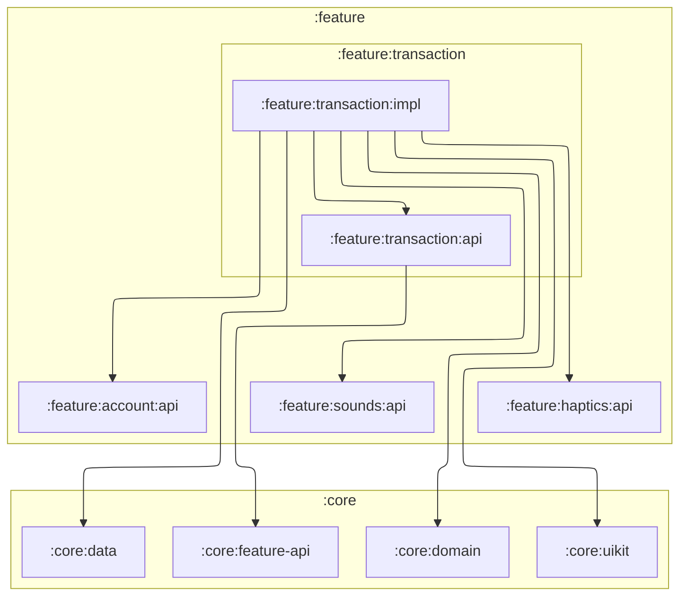

# `:feature:transaction:impl`

## Responsibility

Обработка и отображение транзакции пользователя.

Сохранение и удаление выполняются по одному за раз, а после успеха экран больше не принимает
действий: двойной тап по ✓ не создаст операцию дважды и не изменит баланс счёта второй раз.

Если новую операцию не из чего собрать (нет счёта или категорий нужного типа), экран показывает
пустое состояние: без счёта — кнопку «Создать счёт» (переход на `AccountKey` из
`:feature:account:api`), без категорий — пояснение и «Закрыть». Пока экран открыт, он слушает БД
и сам откроет форму, когда данные появятся; после этого форма уже не пересобирается и ввод не
теряется.

## Module dependency graph

<!--region graph-->

