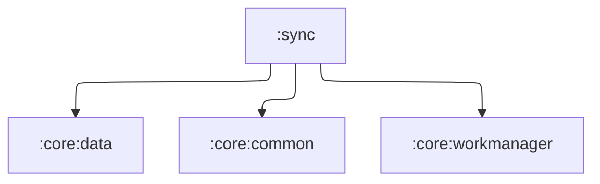

# `:sync`

## Responsibility

Служба синхронизации данных приложения.

Строки foreground-уведомления синка (имя и описание канала, заголовок) лежат в ресурсах модуля
(`res/values`, `res/values-ru`).

## Module dependency graph

<!--region graph-->

